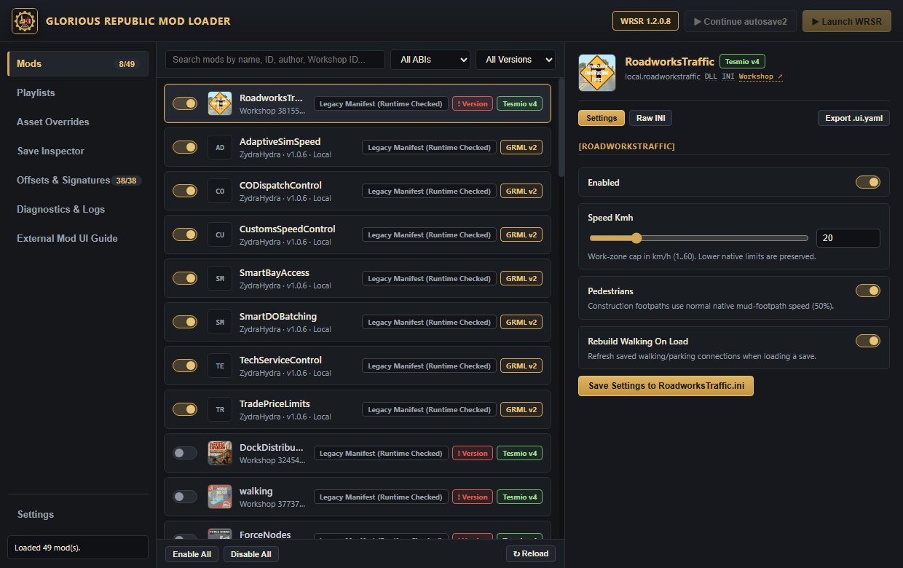
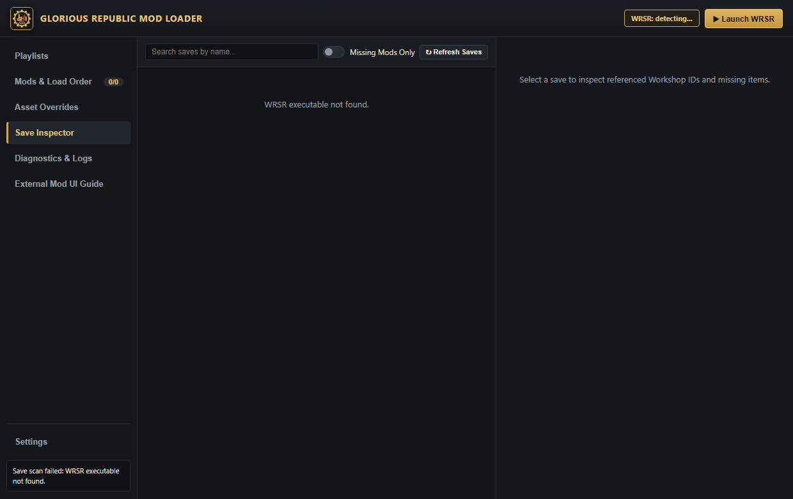
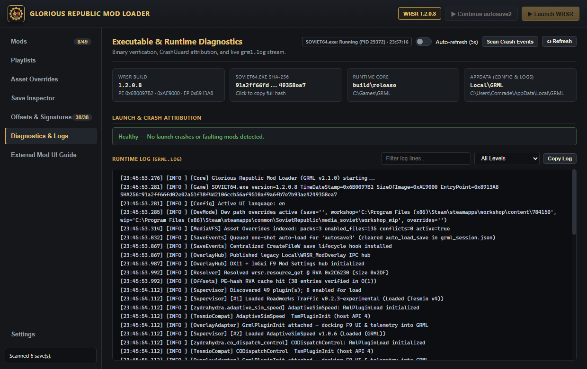
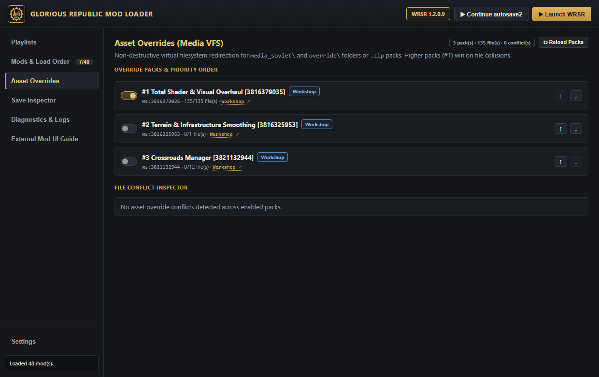
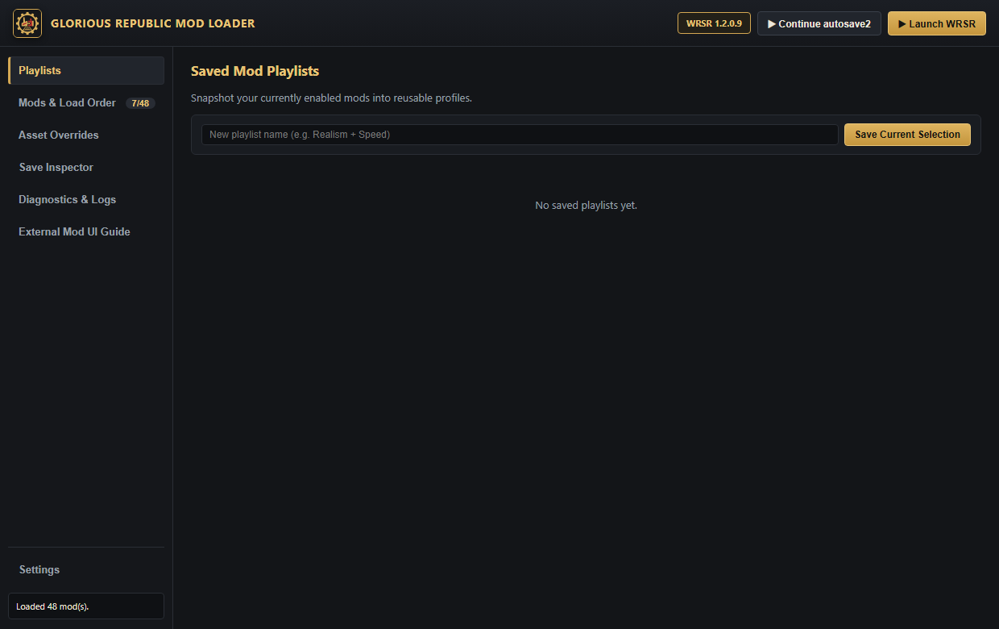
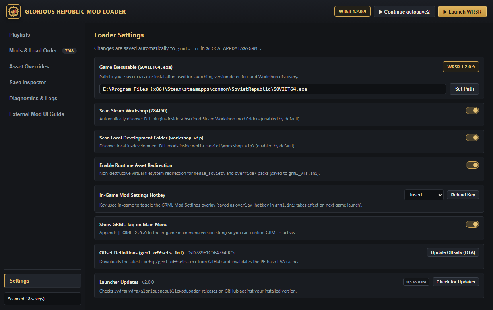
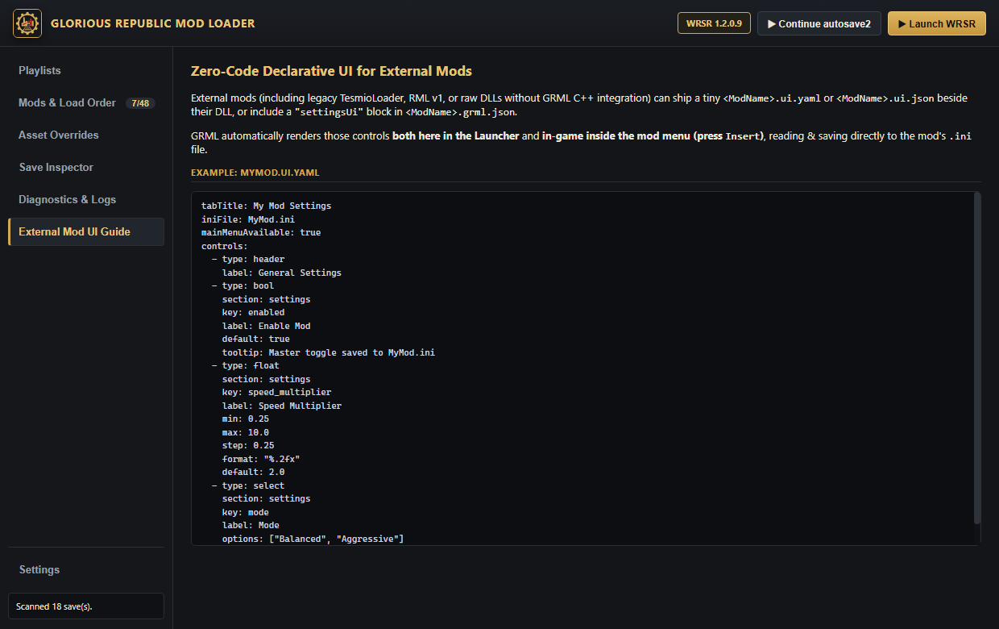
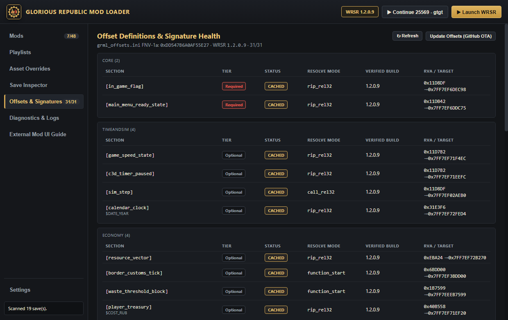
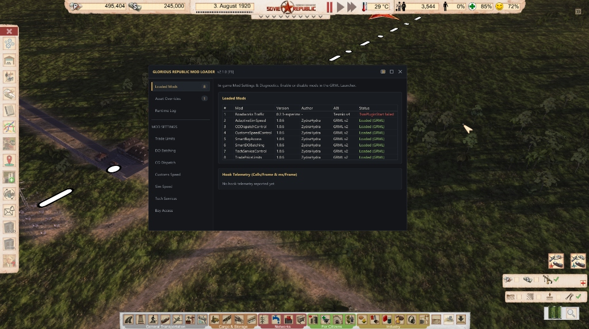

<div align="center">
  
  <h1>Glorious Republic Mod Loader (GRML)</h1>
  <p>
    <strong>Version 2.1.0 (Alpha)</strong> — A fast, lightweight mod loader, <code>F9</code> in-game settings hub, non-destructive asset override manager, and Save Inspector for <strong>Workers &amp; Resources: Soviet Republic</strong> (<code>SOVIET64.exe 1.2.0.9+</code>).
  </p>
  <p>
    <a href="https://github.com/ZydraHydra/GloriousRepublicModLoader/actions/workflows/ci-release.yml"></a>
    <a href="https://github.com/ZydraHydra/GloriousRepublicModLoader/releases"></a>
    <a href="LICENSE"></a>
    
    
  </p>
</div>

> **Alpha Release Notice:** GRML is currently in **public Alpha**. Native memory hooks and Media VFS overrides have been tested on WRSR `1.2.0.9`, and wider testing across hardware, mod lists, and large late-game republics is ongoing. Please back up your saves in `media_soviet\save\` before testing and report any issues or new game patch offsets via [GitHub Issues](https://github.com/ZydraHydra/GloriousRepublicModLoader/issues).

GRML lets you manage Steam Workshop (`784150`) and local DLL mods, tweak mod `.ini` settings from a clean UI or **in-game**, layer non-destructive asset packs, and diagnose crashes or missing Workshop items in your saves—while staying **100% compatible** with existing **RML v1**, **TesmioLoader v3/v4**, and standalone DLL mods.



---

## Features for Players

- **Clean, Self-Contained Launcher:** Runs natively via Microsoft Edge WebView2 (`GloriousRepublicModLoader.exe`) with zero extra runtimes to install, and checks GitHub Releases for newer GRML versions automatically or on demand from **Settings**. All your settings, playlists, mod configs, and logs are stored safely in `%LOCALAPPDATA%\GRML` so updates never overwrite your configuration.
- **Playlists & Mod Management:**
  - Automatically discovers subscribed **Steam Workshop (`784150`)** mods, local `plugins/`, and `workshop_wip/` mods.
  - Newly discovered mods start **disabled by default** until you turn them on.
  - Filter by name, Workshop ID, ABI, or supported game version, and save reusable **Playlists** to switch setups in one click.
  - Automatic dependency & conflict checking with clear version-compatibility badges.
- **Visual Mod Settings (Launcher + In-Game Overlay):**
  - Edit mod settings with sliders, toggles, dropdowns, and tooltips—no manual `.ini` editing required.
  - Even legacy mods that only ship an `.ini` file automatically get a structured settings UI.
  - Press **`F9`** in-game (or rebind any key in **Settings**) to open **GRML Mod Settings** right inside WRSR—featuring the same left-sidebar layout, card panels, and toggle switches as the launcher, plus a unified topbar with sidebar-only collapse (auto-expands on item click), maximize/restore, and close controls.
- **Asset Overrides (Media VFS):**
  - Layer `media_soviet\` / `override\` folders or `.zip` packs (`<GameDir>\media_overrides\` and compatible Workshop items) without modifying game files.
  - Reorder pack priority and inspect file conflicts before launching.
- **Direct-to-Save Launching & Fast Boot:**
  - Click **▶ Continue `<SaveName>`** in the top bar (automatically updated every 5s via `/api/latest-save` from `header.bin` timestamps and `grml_session.json`) or **Launch Save** inside the **Save Inspector** to boot straight into any save.
  - Protected by a one-shot anti-crash-loop guard (`auto_load_save` is cleared in `grml_session.json` before deserialization begins).
  - Automatically skips the 9.5s intro logo timer (`devlogo.dds` / `publogo.dds`) while Workshop & asset indexing runs in the background (toggleable via `skip_intro_logos = 1` in `grml.ini`).
- **Save Inspector & Post-Crash Recovery:**
  - Scan `media_soviet\save\` on demand (sorted newest-first) to see each save's date, size, map template, and referenced Workshop items.
  - Immediately spot **missing Workshop IDs** with **Copy Missing IDs** and direct Steam Client / Web links to resubscribe.
  - If `SOVIET64.exe` crashes after loading a save, GRML alerts you with a one-click **Inspect Save** banner.
- **Diagnostics & CrashGuard:**
  - View live `grml.log` output (with severity highlighting, search, and level filters), Windows crash attribution, and a one-click **Disable Mod** button if a plugin faults.
- **Offsets & Pre-Flight Compatibility:**
  - Inspect all 6 categories of `grml_offsets.ini` signatures on the dedicated **Offsets & Signatures** page with live `OK` / `CACHED` / `MISSING` status, latest verified build + hover history, and one-click OTA updates from GitHub.
  - Pre-flight PE scanning cross-checks each mod's `required_offsets` / `optional_offsets` before launch (`Ready`, `Degraded`, `Needs Offset Update`, `Legacy`) and offers one-click temporary disabling of affected mods.

---

## Quick Start

1. Download and extract the latest **GRML** release (`GloriousRepublicModLoader.exe`, `grml_runtime.dll`, `grml_offsets.ini`) to any folder.
2. Run **`GloriousRepublicModLoader.exe`**.
3. Check the detected WRSR version in the top bar (if your game is in a custom location, set `SOVIET64.exe` under **Settings**).
4. Enable the mods you want in **Mods** (and configure any optional packs in **Asset Overrides**).
5. Click **▶ Launch WRSR** (or **▶ Continue `<SaveName>`** to load your latest save directly). Press **`F9`** (or your custom hotkey) in-game to open **GRML Mod Settings**.

### Where Your Data Is Stored
All user files live in `%LOCALAPPDATA%\GRML`:
- `grml.ini` — enabled mods, game path, discovery options, and overlay hotkey
- `grml_vfs.ini` — Asset Override pack order and toggles
- `configs/<plugin_id>.ini` — update-safe per-mod `.ini` settings for GRML SDK v2 mods
- `grml_playlists.json` — saved mod playlists
- `grml.log` & `grml_session.json` — runtime log and last-loaded-save crash breadcrumb

---

## Screenshots

| Save Inspector | Diagnostics & Logs |
| :---: | :---: |
|  |  |

| Asset Overrides | Playlists |
| :---: | :---: |
|  |  |

| Loader Settings | External Mod UI Guide |
| :---: | :---: |
|  |  |

### Offsets & Signatures


### In-Game Overlay (`F9`)


---

## For Mod Authors & Developers

GRML provides a pure-C ABI (`include/grml_api.h`), declarative UI schemas (`*.ui.yaml` / `*.ui.json` / `"settingsUi"`), and centralized single-pass AOB / `CreateFileW` hooks while preserving full backwards compatibility with **RML v1** (`RmlPluginQuery` / `RmlPluginLoad`) and **TesmioLoader v3/v4** (`TsmPluginApiVersion` / `TsmPluginInit` / `TsmPluginStart`).

### Developer Documentation
- [Architecture Overview](docs/ARCHITECTURE.md)
- [Plugin SDK (`include/grml_api.h`)](docs/PLUGIN_SDK.md)
- [Offsets, PE-Hash Caching & `gen_sig.py`](docs/OFFSETS_AND_SIGNATURES.md)
- [Base Offset Catalog (`config/grml_offsets.ini`)](docs/OFFSET_CATALOG.md)
- [Direct-to-Save Launch & Intro Skip (`SOVIET64.exe` `1.2.0.9`)](docs/DIRECT_SAVE_LOAD.md)
- [Declarative & Auto-Built UI Schema](docs/DECLARATIVE_UI_SCHEMA.md)
- [Hooking & Performance Rules](docs/HOOKING_AND_PERFORMANCE_RULES.md)
- [Repository Guidelines (`AGENTS.md`)](AGENTS.md)
- [Contributing Guide](CONTRIBUTING.md)
- [Code of Conduct](CODE_OF_CONDUCT.md)
- [Security Policy](SECURITY.md)
- [Changelog](CHANGELOG.md)
- [Alpha Release & Marketing Kit](docs/MARKETING.md)

### Building from Source

#### Prerequisites
- Windows 10/11 x64
- Visual Studio 2022 (MSVC C++20 toolset) + CMake 3.24+ + Ninja
- [Node.js](https://nodejs.org/) 20+ (with `npm`)

#### One-Command Clean Build
From PowerShell at the repository root:
```powershell
.\build.ps1
```
This builds the SvelteKit static UI (`src/launcher/ui/` -> `build/dist/`), compiles `GloriousRepublicModLoader.exe` (with embedded WebView2 + UI assets) and `grml_runtime.dll` in Release x64 (`/MT`), and outputs the clean 3-file distribution into `build\release\`. Use `.\test.ps1` to run a full rebuild and automatically launch `GloriousRepublicModLoader.exe` once finished.

### Repository Layout
```text
├── assets/                            # Audio/branding source assets
├── cmake/                             # CMake asset & offset embedding helpers
├── config/                            # Default grml.ini & grml_offsets.ini
├── docs/                              # Architecture, SDK, UI Schema & Hooking rules
├── include/grml_api.h                 # Canonical pure-C host/plugin ABI (v2)
├── scripts/                           # Signature/anchor tooling, i18n check, & screenshot capture
├── src/
│   ├── common/                        # PE/AOB scanner, INI, JSON, Manifest, UI Schema, VFS
│   ├── launcher/                      # Native Win32 + WebView2 host, HTTP API, injector
│   │   └── ui/                        # Svelte 5 + SvelteKit UI sources (lib/, routes/, static/)
│   └── runtime/                       # grml_runtime.dll (overlay hub, hook manager, CrashGuard, VFS)
├── build.ps1                          # Full clean build script -> build\release\
├── test.ps1                           # Full clean rebuild + launch GloriousRepublicModLoader.exe
├── package.json                       # SvelteKit / Vite root toolchain config
├── CMakeLists.txt
├── CHANGELOG.md
└── LICENSE                            # MIT License
```

---

## Special Thanks & Acknowledgements

GRML stands on the shoulders of the *Workers & Resources: Soviet Republic* modding pioneers who defined the plugin ABIs and loader ecosystem that GRML remains compatible with:

- **Ultimate (`Ultimate-Universe`)** — author of [Republic Mod Loader (WRSR-RepublicModLoader)](https://github.com/Ultimate-Universe/WRSR-RepublicModLoader) ([Steam Workshop](https://steamcommunity.com/sharedfiles/filedetails/?id=3787969749)), for designing RML API v1, safe symbol resolution, and Steam Workshop integration patterns.
- **Tesmio (`MaxLegend`)** — creator of [TesmioLoader](https://github.com/MaxLegend/TesmioLoader), for pioneering native code injection and the Tesmio API v3/v4 plugin ecosystem in *Workers & Resources: Soviet Republic*.

---

## License

Licensed under the **MIT License** ([LICENSE](LICENSE)).
